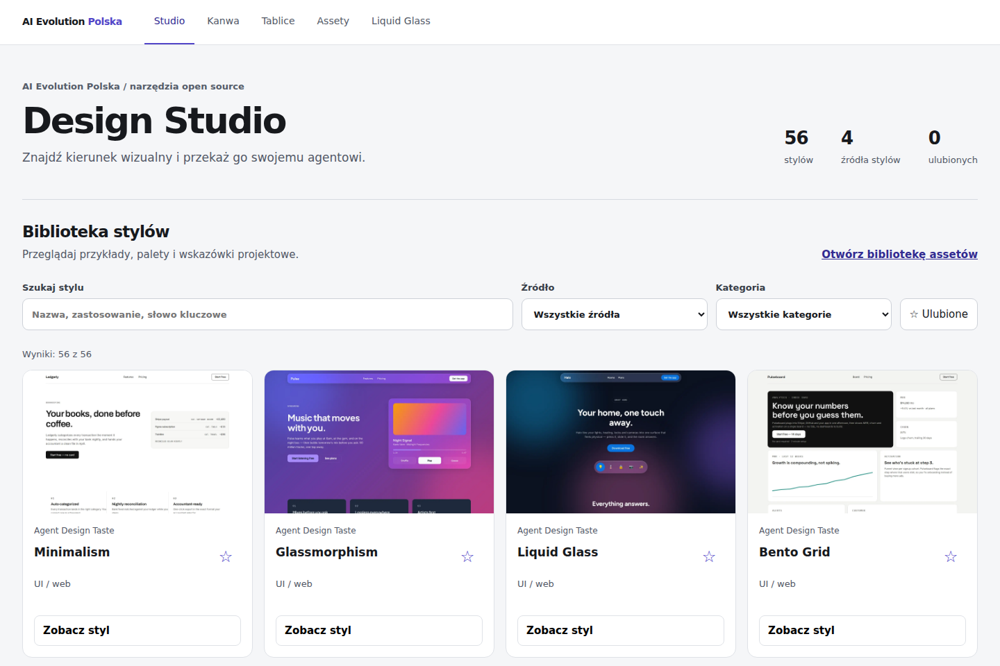
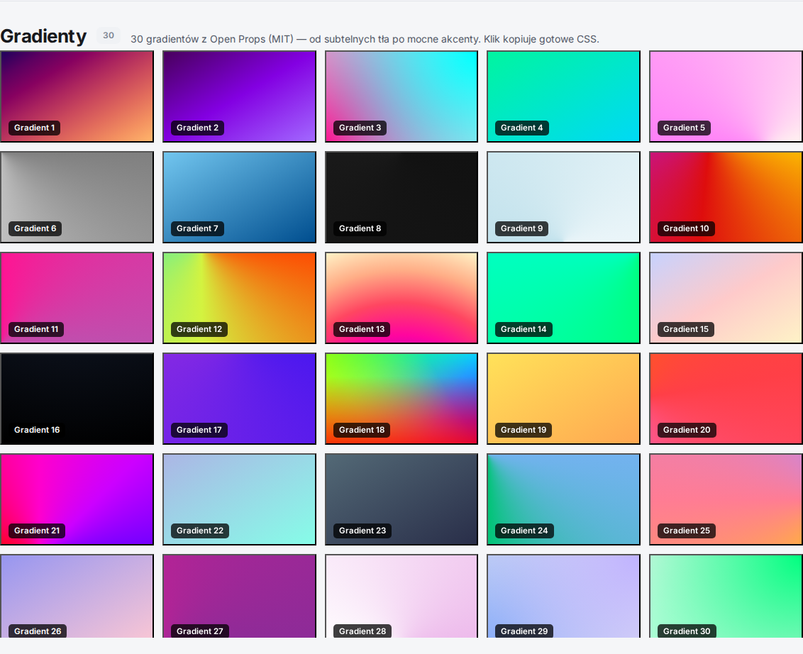
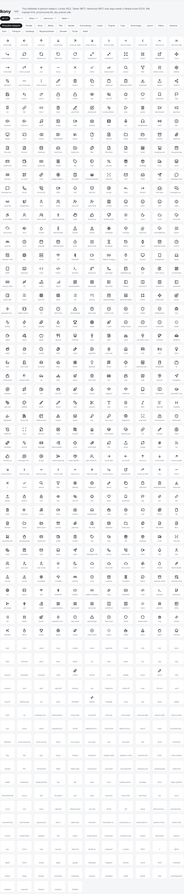
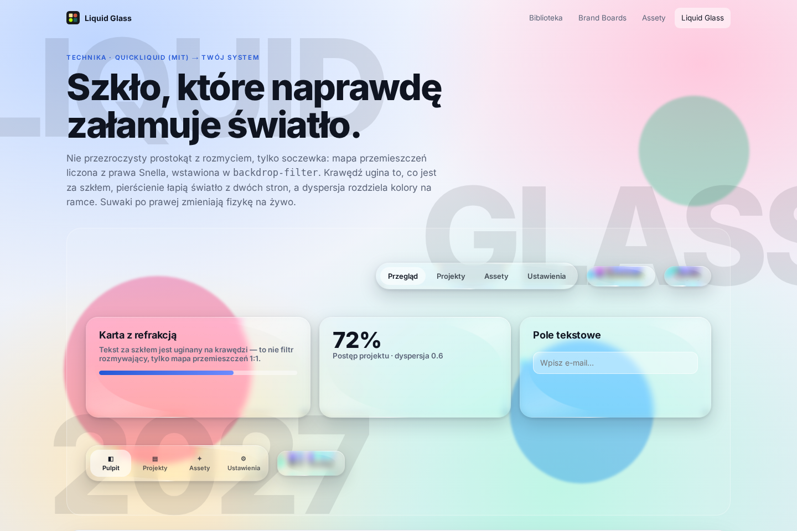

<div align="center">

# AI Evolution Design Studio
### Ty wybierasz kierunek. Agent dostaje konkretne zasady.

**Otwarte środowisko współpracy człowieka i agenta przy projektowaniu stron i aplikacji.**

[Zobacz publiczną bibliotekę](https://aievolutionpl.github.io/design-canvas/) · [Praca z agentem](docs/AGENT-WORKFLOW.md) · [Źródła i licencje](docs/SOURCES.md) · [Uruchom lokalnie](#uruchom-lokalnie)

</div>



Nie zaczynaj kolejnego projektu od „zrób mi ładną stronę”. Wybierz styl, obejrzyj jego paletę i typografię, a następnie przekaż agentowi gotowy kontekst: **co budować, jak komponować i czego unikać**.

Design Studio łączy bibliotekę inspiracji, zasoby do skopiowania i wizualne tablice projektowe. Człowiek podejmuje decyzje estetyczne. Agent dostaje dane, źródła i ograniczenia zamiast zgadywać intencję.

> **Status tej gałęzi:** dashboard `studio.html` i rozszerzona biblioteka są wersją rozwojową. Publiczne demo może pokazywać wcześniejszą wersję. Poniższe zrzuty pochodzą z rzeczywistej aplikacji uruchomionej lokalnie, nie z makiet. Pełna integracja modułów i końcowa weryfikacja pozostają w toku.

## Od inspiracji do projektu

**01 · Odkryj** — wyszukaj kierunek po nazwie, kategorii lub zastosowaniu. Porównaj przykłady i zapisz ulubione.

**02 · Wybierz** — otwórz szczegóły stylu: paleta, fonty, kompozycja, zastosowanie i zasady unikania błędów.

**03 · Przekaż** — kliknij **Kopiuj Markdown** lub **Pobierz JSON**. Dołącz cel projektu i treść, którą ma wykorzystać agent.

**04 · Współtwórz** — agent przygotowuje interfejs. Ty oceniasz kierunek; wspólnie poprawiacie hierarchię, czytelność i zachowanie na telefonie.

Nie potrzeba konta ani klucza API do przeglądania biblioteki. Ulubione dashboardu są przechowywane lokalnie w przeglądarce — nie synchronizują się między urządzeniami.

## Jedno repozytorium, pięć przestrzeni pracy

| Moduł | Do czego służy | Plik |
|---|---|---|
| **Studio** | Szukanie stylów, ulubione, szczegóły i pakiety dla agenta | [`studio.html`](studio.html) |
| **Kanwa** | Przegląd zasobów na przesuwanym i powiększanym płótnie | [`index.html`](index.html) |
| **Tablice stylów** | Koncepcja, typografia, kolor, mockupy, ikony i detale UI w jednym kontekście | [`boards.html`](boards.html) |
| **Biblioteka assetów** | Kopiowanie SVG, CSS, kolorów i przykładów komponentów | [`assets.html`](assets.html) |
| **Laboratorium Liquid Glass** | Regulacja parametrów szkła i podgląd refrakcji na żywo | [`liquid.html`](liquid.html) |

Linki do plików powyżej pokazują kod na GitHubie. Interaktywne strony otworzysz przez lokalny serwer opisany niżej.

## Co znajdziesz w środku?

Stan danych tej wersji: **56 stylów · 147 rodzin fontów · 698 ikon · 87 wzorów · 30 gradientów · 77 palet**. To liczby rekordów katalogów, nie deklaracja przetestowania każdego możliwego połączenia.

### Style, które można przekazać agentowi

Minimalizm, układy Bento, kierunki redakcyjne, brutalizm, interfejsy techniczne i materiały takie jak szkło. Kolekcja obejmuje Agent Design Taste, prognozy trendów, Liquid Glass oraz **8 autorskich kompozycji AI Evolution Polska**.

Każdy kierunek ma własny identyfikator. Próbkowane kolory, sugerowane fonty i autorskie kompozycje nie są przedstawiane jako oficjalne tokeny cudzych marek. Prognoza trendu to inspiracja, nie gwarancja przyszłej popularności.

### Gradienty i tła — zobacz, kliknij, wykorzystaj



Kliknięcie gradientu kopiuje CSS. Wzory i tekstury pomagają zbudować tło dla interfejsu, sekcji lub prezentacji. Kopiowany zasób jest punktem wyjścia — dopasuj go do treści i sprawdź kontrast.

### Ikony i paczki open source

<details>
<summary><strong>Zobacz bibliotekę ikon</strong></summary>



</details>

- **Lucide, Tabler, Heroicons i Simple Icons** — katalog ikon; prawa do znaków marek nie znikają wraz z licencją plików.
- **Hero Patterns** — powtarzalne wzory tła.
- **Open Props** — tokeny i materiały do budowania własnego systemu UI.
- **Open Color, Radix Colors, Catppuccin, Nord i Tailwind** — źródła palet.
- **DiceBear Open Peeps** — ilustracje.
- **Google Fonts** — katalog krojów; fonty pobierane są z usługi, nie wszystkie są lokalnie dołączone.
- **Phosphor** — mały zestaw źródłowy w `assets/vendor/phosphor`; nie jest jeszcze częścią głównej siatki ikon.

Lista źródeł podstawowej biblioteki: [`data/assets.json`](data/assets.json), pole `licenses`. Nowe źródła, rewizje i sumy plików: [`data/source-ledger.json`](data/source-ledger.json).

### Liquid Glass — materiał, nie przezroczysty prostokąt



Laboratorium pozwala zmieniać parametry soczewki i obserwować załamanie tła. Implementacja bazuje na technice z [quickLiquid](https://github.com/amarnath3003/quickLiquid): mapa przemieszczeń, filtr SVG i warstwy światła.

**Przykłady użycia:** pływająca nawigacja, przyciski nad zdjęciem, kontrolki na mapie, karty nad kolorowym tłem. Podgląd szkła na tablicy jest ilustracją kierunku; działający efekt znajduje się w laboratorium i bibliotece. Zachowanie filtrów może różnić się między przeglądarkami — sprawdzaj docelowe urządzenia.

## Człowiek + agent: wspólny język designu

```text
CZŁOWIEK                  DESIGN STUDIO                   AGENT
cel i odbiorca     →       wybór stylu              →      interpretacja briefu
ocena wizualna     ←       podglądy i tokeny        ←      propozycja interfejsu
akceptacja        →       Markdown / JSON          →      implementacja + testy
```

### Gotowy brief do wklejenia

```text
Pracujemy z AI Evolution Design Studio.
Poniżej wklejam pakiet wybranego stylu.

Projekt: strona zapisów na warsztaty fotograficzne.
Odbiorcy: osoby początkujące, korzystające głównie z telefonu.
Najważniejsza akcja: wybór terminu i zapis.

Najpierw zaproponuj hierarchię treści i zastosowanie stylu.
Użyj dostarczonych kolorów, fontów i zasad kompozycji.
Nie wymyślaj opinii klientów, statystyk ani brakujących zdjęć.
Sprawdź klawiaturę, kontrast i układ mobilny.
Gdy zmieniasz regułę stylu, krótko wyjaśnij dlaczego.

[PAKIET MARKDOWN ZE STUDIO]
```

**Dla agentów pracujących z repozytorium:** zacznij od [`AGENTS.md`](AGENTS.md). Pełna procedura i format eksportu: [`docs/AGENT-WORKFLOW.md`](docs/AGENT-WORKFLOW.md).

To **biblioteka przyjazna agentom**, nie automatyczny generator stron ani zainstalowana wtyczka MCP. Współpraca działa przez zwykły tekst, eksport JSON i pliki repozytorium; agent nie musi korzystać z konkretnego dostawcy modelu.

## Uruchom lokalnie

Wymagania: Git, Python 3 i współczesna przeglądarka. Bez bundlera i instalowania zależności aplikacji.

```bash
git clone https://github.com/aievolutionpl/design-canvas.git
cd design-canvas
git switch work/design-studio-audit
python3 -m http.server 8000
```

Otwórz **http://localhost:8000/studio.html**. Nie uruchamiaj przez `file://` — katalogi danych są pobierane przez `fetch()`.

Fonty z Google wymagają internetu. Część efektów korzysta z nowoczesnych funkcji CSS/SVG.

## Rozwijaj bibliotekę razem z nami

1. Dodaj styl do `data/styles.json` z unikalnym `id`, opisem, paletą, typografią i promptem.
2. Wskaż źródło. Oznacz własną kompozycję jako autorską, nie jako kopię systemu źródłowego.
3. Dołącz licencję każdego kopiowanego zasobu i aktualizuj wykaz źródeł.
4. Sprawdź podgląd, wyszukiwanie i eksport. Dla assetów sprawdź także skopiowany kod poza biblioteką.
5. Otwórz pull request z rzeczywistym zrzutem i opisem testów.

Nie dodawaj kluczy API, danych klientów, materiałów bez prawa redystrybucji ani samych dekoracyjnych kafli bez użytecznego zasobu.

## Jakość i ograniczenia

Testy przeglądarkowe znajdują się w `tools/`. `tools/audit_assets.py` sprawdza bibliotekę assetów, w tym renderowanie skopiowanych fragmentów. Starszy `tools/verify.py` zawiera założenia dotyczące wcześniejszych liczebności — nie traktuj go jako aktualnej bramki całego Studio bez aktualizacji.

Projekt zawiera zasoby na różnych licencjach. Nie zakładaj, że jedna licencja obejmuje wszystkie fonty, ikony, ilustracje i materiały źródłowe. Sprawdź [opis źródeł](docs/SOURCES.md) oraz licencję konkretnej paczki przed redystrybucją.

---

**Projekt AI Evolution Polska** · [aievolutionpolska.pl](https://aievolutionpolska.pl)

Rozwijany z pomocą agentów AI. Treści i rekomendacje mogą zawierać błędy — weryfikuj źródła, dostępność i zachowanie przed użyciem produkcyjnym.
